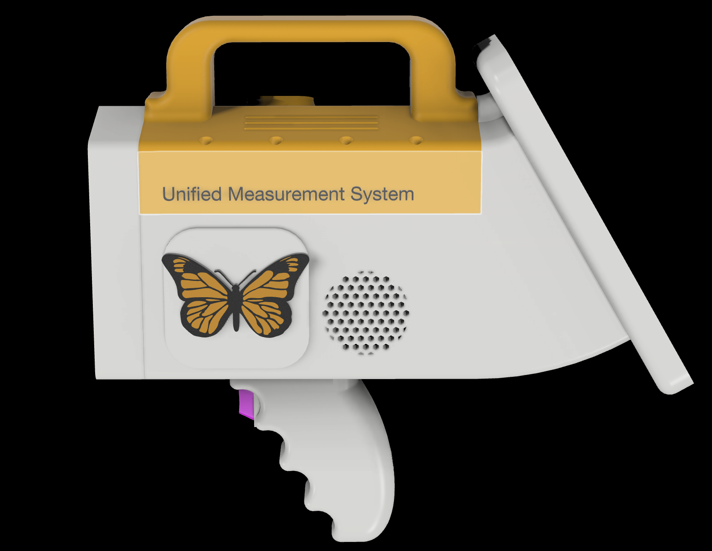
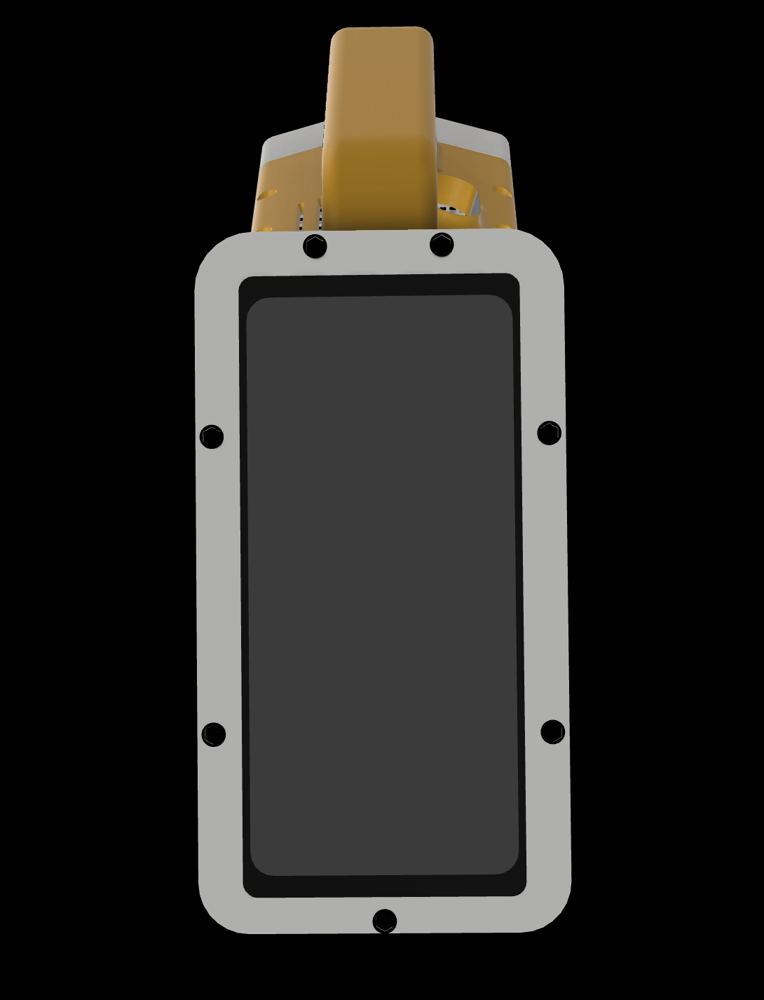
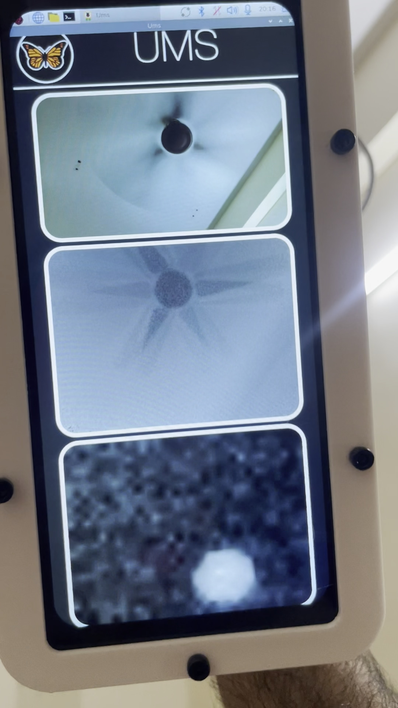

# UMS (Unified Measurement System)

UMS is a multimodal scene capture platform combining quasi-synchronous RGB imaging, time-of-flight depth imaging, thermal imaging, and any other acquisition modality in a single platform.

The system is built around a Raspberry Pi 5, with custom mechanical hardware and a C++ acquisition framework for handling multiple sensing subsystems.

*UMS Profile.*

*UMS Screen.*

*UMS UI.*

## Hardware Overview

UMS uses a Raspberry Pi 5 as its base:
- Raspberry Pi 5 handles computation and acquisition.
- Raspberry Pi Camera Module 3 captures RGB imagery.
- Arducam ToF camera captures depth data.
- MLX90640 provides 32 × 24 thermal imaging.
- MicroSD is used for storage.

## Software Architecture

The acquisition software is written in C++ and follows a modular, subsystem-oriented architecture.

Each sensor has its own subsystem responsible for acquisition and sensor-specific data handling. A common base architecture handles lifecycle management, acquisition states, frame ownership, capture coordination, buffering, and writing.

The software includes:
- **Subsystem Management:** Common lifecycle and acquisition-state handling.
- **Frame Handling:** Frame representations and metadata.
- **Buffered Acquisition:** Separation of acquisition and data writing.
- **Capture Coordination:** A common interface for controlling imaging subsystems.
- **Timestamping:** A shared monotonic clock reference for imaging frames.
- **Preview:** Sensor-specific live previews where supported.
- **Custom Video Pipelines:** Custom depth video capture pipelines are implemented in the `UmsDaemon`.

**NOTE:** *UMS was designed with extensibility in mind, abstraction provided in the subsystem class is substantial enough for easy porting of any sensing modality.*

### Capture Modes

The physical control supports two imaging modes:
- Short press captures a still image from the imaging subsystems.
- Long press starts or stops video capture across the imaging subsystems.

Each acquisition subsystem runs its own acquisition thread. Imaging frames are timestamped using `std::chrono::steady_clock`.

The system provides a common software time reference, but does not guarantee simultaneous hardware acquisition.

### RGB and ToF Integration

The Raspberry Pi Camera Module 3 uses the Raspberry Pi camera stack, while the Arducam ToF camera relies on its own driver and SDK.

The acquisition software accommodates both interfaces, allowing the cameras to operate within the same platform.

### Depth Processing

The ToF subsystem supports acquisition, preview, storage, and point-cloud generation.

Captured depth data can be converted into XYZ point clouds for further processing

### Thermal Imaging

The MLX90640 subsystem supports thermal acquisition, processing, display, and video capture.

The sensor produces a 32 × 24 temperature field, allowing spatial temperature distributions and their changes over time to be recorded.

## Known Limitations

- Imaging subsystems share a software trigger and monotonic clock, but simultaneous physical acquisition is not guaranteed, however it is an easy fix if needed.
- RGB follows a separate acquisition path and does not share the other imaging subsystems' common acquisition machinery.
- Depth and thermal measurements are subject to the limitations of their respective sensors.
- Sustained recording performance depends on acquisition rates, buffering, and storage throughput.
- Camera operation depends on driver configuration and compatibility between the Raspberry Pi camera stack and the Arducam SDK.